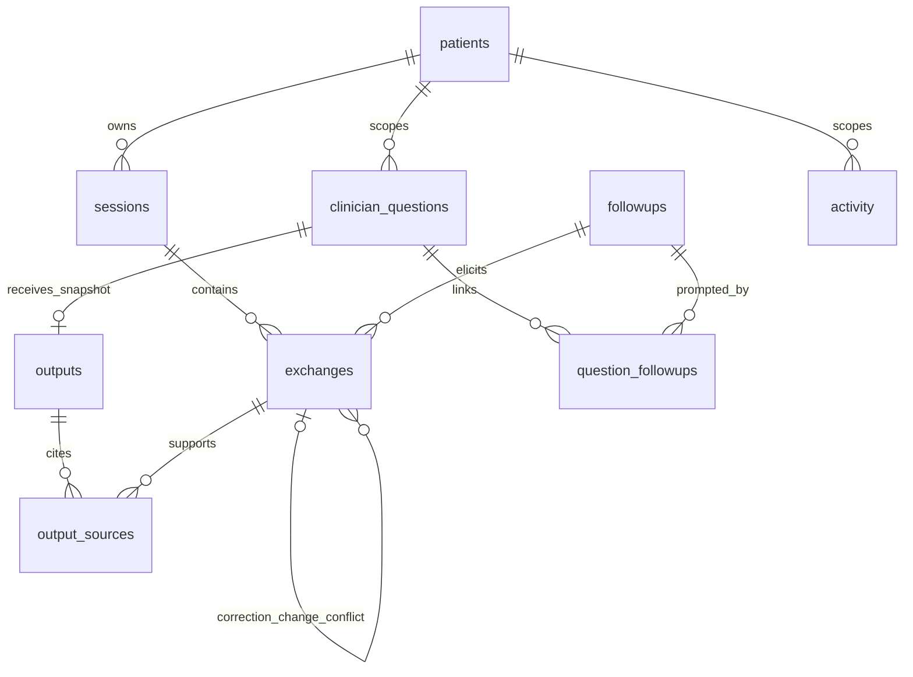

# THE VISION

Preserve a fictional patient's own history over time and make the limits of that history visible. A simulated clinician can retrieve what was actually reported, see the original context, and identify a missing detail. A proposed, approved follow-up gives the patient an opportunity to enrich the record at a later check-in. The application never diagnoses, recommends treatment, invents consent, or speaks for an unavailable patient.

# THE DESIGN

The record contains immutable original exchanges and separate derived outputs. Trusted application context selects the patient. Every database relationship includes patient scope; the provider cannot change it. A question about absent evidence creates workflow context, never a source fact. Approving a question adds it to the check-in queue; submitting an answer adds an original exchange linked back to the proposal and its clinician questions. No retraining, cross-patient learning, shared library modification, or shared conversation state occurs.

The small offline provider selects full verbatim source answers. The real Ollama adapter requests structured claim-level IDs and uncertainty. Application validation checks retrieved-set membership, patient identity, relevant topic/entity examples, full-answer equality, and completeness of relevant statements. Patient identity, displayed quotations, and timestamps come from SQLite, not generated text. A valid schema establishes structure; a matching ID establishes source identity. Neither proves interpretation or medical truth. A reviewer sees original exchanges and can append a correction.

This conservative extractive design trades fluent paraphrases for a more inspectable first version. Semantic relevance rules include distinct synthetic examples (asthma versus migraine; consciousness versus asthma; an off-topic color answer; medication dose absent from a medication mention). They do not constitute general medical entailment. Unknown/declined/skipped/uncertain, explicitly linked conflicts, and temporal relationships remain visible.

## Data relationships

`patients` persists schedule and record revision. `sessions` groups interviews/check-ins/corrections. `exchanges` stores exact question/answer, state, respondent, origin, topic, UTC recording time, separate reported event wording/precision, and links. A SQL trigger rejects updates/deletes of originals. `clinician_questions` persists simulated identity/time/outcome. `followups` has proposed/approved/asked/answered/declined/dismissed state and a **separate** resolved flag. `question_followups` links repeated questions to one unresolved gap. `outputs` stores derived payload, actual mode/model, prompt version, generation time, input revision, search disclosure, and visible errors. `output_sources` connects snapshots to immutable original context. `activity` records actions/IDs without duplicating source text.

Composite foreign keys enforce same-patient links. Parameterized values avoid SQL injection; table names come from internal allowlists. Unique patient/token constraints and payload hashes make retries idempotent and reject token reuse with changed content. Multi-step mutations use transactions; evidence/revision are read as a snapshot before inference. Runtime files remain local/ignored. This is not an audited tamper-resistant or encrypted record system.

## Follow-up lifecycle

Proposed → clinician edits/approves → approved → displayed in interview → asked. A response appends an exchange: skipped stays asked/open for a later session; declined becomes declined/unresolved; unknown/uncertain becomes answered/unresolved for review; a narrowly recognizable substantive consciousness report/denial can be answered/resolved. Other substantive replies require explicit review with an explanation or requeue. Ending a check-in never resolves a gap. Dismissal records a workflow decision, not a patient denial. The UI displays both workflow state and information resolution.

Open proposals deduplicate by patient/topic, with separate dose/frequency/date facets and normalized text hashes for unknown topics. This modest grouping can combine distinct questions within a broad topic; reviewers should edit a proposal or dismiss it and create a new query when needed. Proposed questions come from neutral library/history templates; unsafe clinician requests are logged without being automatically converted.

Scheduling uses an injected timezone-aware clock. Completing a check-in persists its completion time and computes the next due time using the configured interval. Changing the interval affects future completions; postponement changes the current due time. Simulating due changes only the schedule. There are no background notifications. Recording time never masquerades as event time; normalized dates remain null, including July 2025 and "last July".

# THE CURRENT REALIZATION

## Code layout

The UI is `app.py`; storage is `db.py`/`schema.sql`; application workflows are `service.py`; interview/library rules are `interview.py`; search and validation are `retrieval.py`/`evidence.py`; provider/network behavior is `providers.py`; contracts and versioned prompts are `models.py`/`prompts.py`. `clock.py`, `config.py`, `seed.py`, and `cli.py` handle time, local settings, synthetic import, and confirmed reset. Fixtures are tracked separately from runtime data. Tests use temporary databases.

## Interview runtime sequence

1. The UI selects a trusted patient ID and clears prior role/patient/mode widget context. No answer cache or shared mutable provider conversation is retained.
2. The service creates an idempotent session and offers approved open follow-ups, then suitable library questions. Check-ins also cover changes. Draft clarifications are optional; they are not source evidence.
3. A validated `Submission` carries the exact question shown and exact submitted answer. One transaction checks session/patient/approval, appends the immutable exchange, increments revision, links the gap, and records activity.
4. Only after commit does optional provider clarification run. Failure displays an error and leaves the next library question and already stored response available. Unsafe/repeated/out-of-scope drafts are rejected.
5. A summary generates a separate snapshot with original links. Patient review is a separate activity, not a source exchange or clinical verification. Corrections append linked records rather than overwrite; stale summary review is refused.

## Clinician runtime sequence

1. Persist the question, patient, simulated clinician identity, UTC time, and idempotency token.
2. Read the selected patient's original exchanges/revision in one transaction. Search topic/text and include related records/contradictions. Disclose searched recording-time range, total/relevant count, and configured bounds.
3. Refuse out-of-scope requests without generating a diagnostic response or follow-up. Block oversized context instead of silently truncating it. Otherwise invoke the explicitly selected provider with no model tools.
4. Validate every claim; merge application uncertainty. Missing-dose/frequency/exact-date facets prevent treating a general mention as the requested detail. Reject unsupported interpretation; on errors keep relevant originals visible with an uncertainty/error message and no manufactured conclusion.
5. Persist a historical output/source snapshot and clinician outcome. Missing/insufficient evidence proposes a neutral gap for review, with links back to every associated question.
6. After a later patient response, a fresh clinician query produces a new snapshot. Old answers keep their timestamp and sources. Older snapshots are labeled when the record revision has changed.

Offline/UI/service tests and an actual loopback launch were executed; no real-model inference or clinical validation was performed. See `test_report.md` for the precise evidence.
